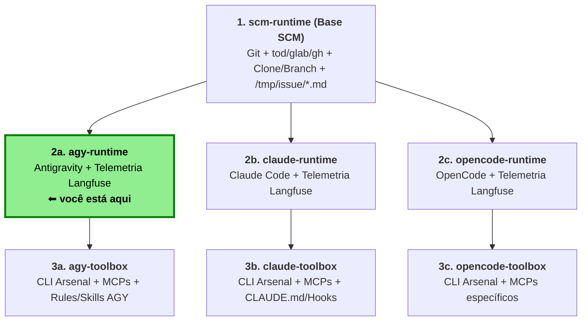

## Visão geral

`agy-runtime` é um runtime Docker para o **Google Antigravity CLI (`agy`)** que estende a imagem base `scm-runtime`.

Ele incorpora o CLI do Antigravity (`agy`), o plugin nativo `langfuse-observability` (via lifecycle hook `Stop` enviando OTLP HTTP JSON para o Langfuse) e a injeção automática de regras (`~/.gemini/config/rules/runtime-*.md`) geradas a partir do repositório e, opcionalmente, de uma issue do projeto.

O arsenal de ferramentas CLI (`mise`), utilitários extras de sistema (`apt`) e o suporte a Docker-in-Docker (`DIND=1`) ficam na Camada 3 (`003-agy-toolbox-core`).

---

## Runtime (`agy.sh`)

O script em `rootfs/usr/local/bin/agy.sh`:

* Sincroniza o plugin `langfuse-observability` em `~/.gemini/config/plugins/langfuse-observability` (funcionando mesmo quando `/home/agent/.gemini` é montado via volume externo para persistir o login OAuth).
* Monta as regras `~/.gemini/config/rules/runtime-01-repo.md`, `runtime-02-cli.md`, `runtime-03-issue.md` e (opcionalmente) `runtime-04-comments.md` com `trigger: always_on`.
* Exporta tags de rastreio para o Langfuse (`mode:interactive` ou `mode:autonomous`) e `LANGFUSE_USER_ID`.
* Inicializa o `agy` interativamente por padrão (`agy --dangerously-skip-permissions`), com `-i "$ISSUE_PROMPT"` se `ISSUE_PROMPT` for definido, ou em modo autônomo (`agy --dangerously-skip-permissions -p "$ISSUE_PROMPT"`).
* Usa `MODEL` opcional para definir o modelo do Antigravity (`agy --model "$MODEL"`).

### Variáveis de Ambiente-chave (`agy-runtime`)

| Variável         | Obrigatória | Descrição                                                       | Exemplo                 |
|------------------|-------------|-----------------------------------------------------------------|-------------------------|
| `ISSUE_PROMPT`   | Opcional    | Prompt inicial enviado ao `agy`                                 | `Resolva a issue`       |
| `ISSUE_COMMENTS` | Opcional    | `true` para incluir `/tmp/issue/comments.md` nas rules          | `true`                  |
| `MODEL`          | Opcional    | Modelo do Antigravity CLI (`--model`, consulte `agy models`)    | `gemini-4-argon-medium` |

### Construindo a Imagem `agy-runtime`

```bash
docker build -t agy-runtime:latest .
```

### Executando o `agy-runtime`

```bash
docker run --rm -it \
  -v "$PWD/env/gemini:/home/agent/.gemini" \
  --env-file .env \
  agy-runtime:latest
```

* **Interativo** – executa o container sem `AUTONOMOUS_MODE`; abre o TUI do `agy`.
* **Autônomo** – defina `AUTONOMOUS_MODE=true` e `ISSUE_ID` (ou `ISSUE_PROMPT`) para executar em modo não-interativo (`agy -p`) e publicar a saída na issue.

---

## Telemetria Langfuse

* **Plugin nativo**: `langfuse-observability` instalado no build via `agy plugin install https://github.com/uaiso-serious/agy-langfuse-plugin` em `~/.gemini/config/plugins/langfuse-observability`.
* **Protocolo**: Envia spans e generations via **OTLP HTTP JSON** (`POST /api/public/otel/v1/traces`), compatível com Langfuse v4 (`events_only`) e v3, usando apenas `bash` + `jq` + `curl` no evento `Stop`.
* **Variáveis de ambiente necessárias (tempo de execução)**:

```dotenv
LANGFUSE_PUBLIC_KEY=pk-lf-...
LANGFUSE_SECRET_KEY=sk-lf-...
LANGFUSE_BASE_URL=http://langfuse.example.com
```

Quando `LANGFUSE_USER_ID` não é informado, faz fallback para o e-mail de `GIT_CO_AUTHOR` e, em seguida, para `GIT_USER_EMAIL`:

```dotenv
LANGFUSE_USER_ID=some-user
```
